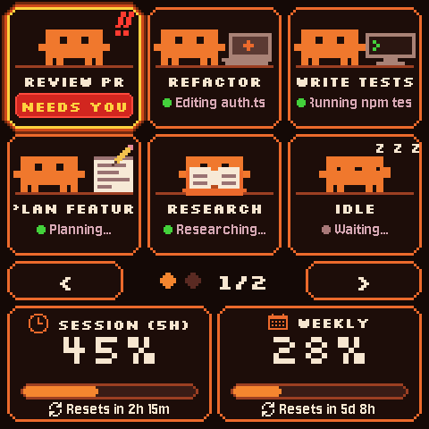

# AI Panel

A desk display that shows what each of your Claude Code sessions is doing. It runs on a
**Guition ESP32-S3-4848S040** (480×480 touch panel) connected over **USB only**, with no WiFi
and no Bluetooth.



```
Claude Code ──hooks──────▶ ~/.ai-panel/hook.sh ──┐
            ──statusLine─▶ ai-panel statusline ──┤ unix socket ~/.ai-panel/sock
                                                 ▼
                                      ai-panel daemon (session state machine)
                                                 │ NDJSON over USB serial @ 115200
                                                 ▼
                                      ESP32-S3 firmware (ESP-IDF + LVGL 9)
```

* **Cards** (6 per page, up to 18): one per session. The title is the project folder, and the
  status line shows what the session is doing now (`Editing main.c`, `Running npm test`,
  `Researching…`, `Planning…`). A card that **needs you** (a permission prompt, a question, or a plan
  ready for approval) glows and shows a red pill, and the panel jumps to its page.
* **Usage tiles**: the 5-hour session % and the weekly %, with reset countdowns. These come from
  the statusLine `rate_limits` field, which is only available on Pro/Max plans and only after the
  first response in a session. Per-model weekly usage is not exposed by Claude Code, so the
  "FABLE" tile from the design is not shown.
* **Navigation**: tap the arrows or swipe left/right. The backlight dims after 10 minutes with no
  activity.

## Repo layout

| Path | What |
|---|---|
| `firmware/` | ESP-IDF project (LCD/touch drivers, serial link, LVGL UI, pixel sprites/fonts) |
| `companion/` | Node/TypeScript CLI `ai-panel` (daemon, hooks, statusLine, installer, demo) |
| `protocol/PROTOCOL.md` | Wire protocol between host and panel |
| `tools/ui-preview/` | Render the firmware UI on the Mac without the board (`build.sh` → PNGs) |
| `CLAUDE.md` | Notes for AI assistants: hardware quirks, workflows, style rules |

## 1. Flash the firmware

Requires **ESP-IDF v5.3 or newer** (tested against the v5.4 APIs).

```sh
# one-time toolchain setup (~2 GB)
mkdir -p ~/esp && cd ~/esp
git clone --depth 1 --branch v5.4.2 --recursive --shallow-submodules https://github.com/espressif/esp-idf.git
./esp-idf/install.sh esp32s3

# build + flash (from the repo root)
tools/flash.sh                     # asks which serial port to use
tools/flash.sh monitor             # same, then shows the serial console (Ctrl+] to exit)
PORT=/dev/cu.usbserial-XXXX tools/flash.sh # skip the port prompt
```

`tools/flash.sh` loads the ESP-IDF environment (`~/esp/esp-idf/export.sh`, or `$IDF_EXPORT`) if it isn't
already active, then runs `idf.py flash` in `firmware/`. Any extra arguments go to `idf.py`.
Only one program can open the serial port at a time, so the script stops the `ai-panel` daemon and
`ai-panel demo` before flashing and restarts the daemon when it exits.

The board's USB-C port goes through a CH340 USB-UART bridge (VID `1a86`), which is wired to UART0.
On macOS it appears as `/dev/cu.usbserial-*`; the number depends on the USB socket. The firmware
console shares that port at 115200 baud, and the daemon ignores any non-JSON lines.

To run `idf.py` directly (e.g. `menuconfig`, `reconfigure`), first run `. ~/esp/esp-idf/export.sh` in
that shell, and stop the daemon yourself if you need the port.

After flashing, the panel shows **WAITING FOR HOST** until the daemon connects.

## 2. Install the companion

Requires Node 20+.

```sh
cd companion
npm install && npm run build
npm link                  # puts `ai-panel` on your PATH (optional)

ai-panel demo             # optional: shows the design mock data on the panel (Ctrl+C to stop)
ai-panel install          # adds hooks + statusLine to ~/.claude/settings.json, starts the launchd daemon
ai-panel status           # shows daemon / panel / session state
```

`install` does the following:

* Writes `~/.ai-panel/hook.sh`, a tiny `nc -U` forwarder that takes about 10 ms and never blocks
  Claude. It registers that script for the session, prompt, tool, permission, notification, and
  stop hooks in `~/.claude/settings.json`. All of these run `async` except `PreToolUse`, which
  cannot be async.
* Points `statusLine` at `ai-panel statusline`. If you already had a statusLine, it is
  remembered and still runs, so its output looks the same as before.
* Backs up `settings.json` to `settings.json.ai-panel-backup-<timestamp>` before every change.
* Installs `~/Library/LaunchAgents/gg.ai-panel.plist` so the daemon starts at login. The log is
  at `~/.ai-panel/daemon.log`. Pass `--no-launchd` and run `ai-panel daemon -v` yourself if you
  prefer.

`ai-panel uninstall` reverses all of this. Sessions that were already open pick up the hooks after
they restart.

Optional `~/.ai-panel/config.json`:

```json
{ "port": "/dev/cu.usbserial-XXXX", "baud": 115200 }
```

Both fields are optional. Without `"port"`, the daemon tries each USB serial device with a CH340
(`1a86`), Espressif (`303a`) or CP210x (`10c4`) vendor ID. It sends only a `ping` and uses the first
one that answers with the panel's `hello`. A device that doesn't answer within 4 s is closed again
and left alone for a minute. That way, other boards, like an Arduino, never get session data.

## How session state is derived

| Claude Code event | Card |
|---|---|
| `SessionStart`, `Notification(idle_prompt)` | sleeping, *Waiting…* |
| `UserPromptSubmit` | thought bubble, *Thinking…* (notepad + pencil, *Planning…*, in plan mode) |
| `PreToolUse` Edit/Write | laptop, *Editing file* |
| `PreToolUse` Read/Grep/Glob/Web* | book, *Researching…* |
| `PreToolUse` Bash | terminal `>_`, *Running cmd*; coffee mug if still running after 10 s |
| `PreToolUse` Task/Agent | thought bubble, *Delegating…* |
| `PermissionRequest`, `Notification(permission_prompt)`, `AskUserQuestion`, `ExitPlanMode` | **NEEDS YOU** |
| `PostToolUse` / `PermissionDenied` | back to *Thinking…* |
| `Stop` | *Done* ✓ for 60 s, then *Waiting…* |
| `StopFailure` | error ✗ |
| `SessionEnd`, or 2 h with no events | removed |

A working scene stays up for at least 2 s, so a burst of tool calls doesn't flicker. *NEEDS YOU*
always shows immediately. The logic is in `companion/src/sessions.ts` and is covered by `npm test`.

## Troubleshooting

* **Black screen, but the backlight is on**: the ST7701 init sequence or the RGB timings don't match
  your panel batch. Both are in `firmware/main/board/display.c`. Try `pclk_hz` 12 MHz, or set
  `pclk_active_neg = 1`.
* **Touch doesn't respond**: the log prints `GT911 not found`. The firmware tries I2C addresses
  0x5D and 0x14.
* **`ai-panel status` says the panel is not connected**: another program has the port open
  (`tools/flash.sh monitor`, `idf.py monitor`, `ai-panel demo`), or the panel isn't answering `ping`
  (old firmware or a crash). Run `ai-panel daemon -v` (with the launchd agent stopped) to see
  `probing …` / `no hello` lines for each port.
* **Usage tiles show "—"**: no statusLine update has arrived yet, or your plan doesn't report rate
  limits.

## Credits

The fonts are [Silkscreen](https://github.com/googlefonts/silkscreen) and
[Jersey 10](https://github.com/scfried/soft-type-jersey), both under the SIL OFL 1.1 (see
`firmware/main/ui/fonts/OFL-*.txt`), converted with `lv_font_conv`. The sprites are original pixel
art defined in `firmware/main/ui/sprites.c`.
